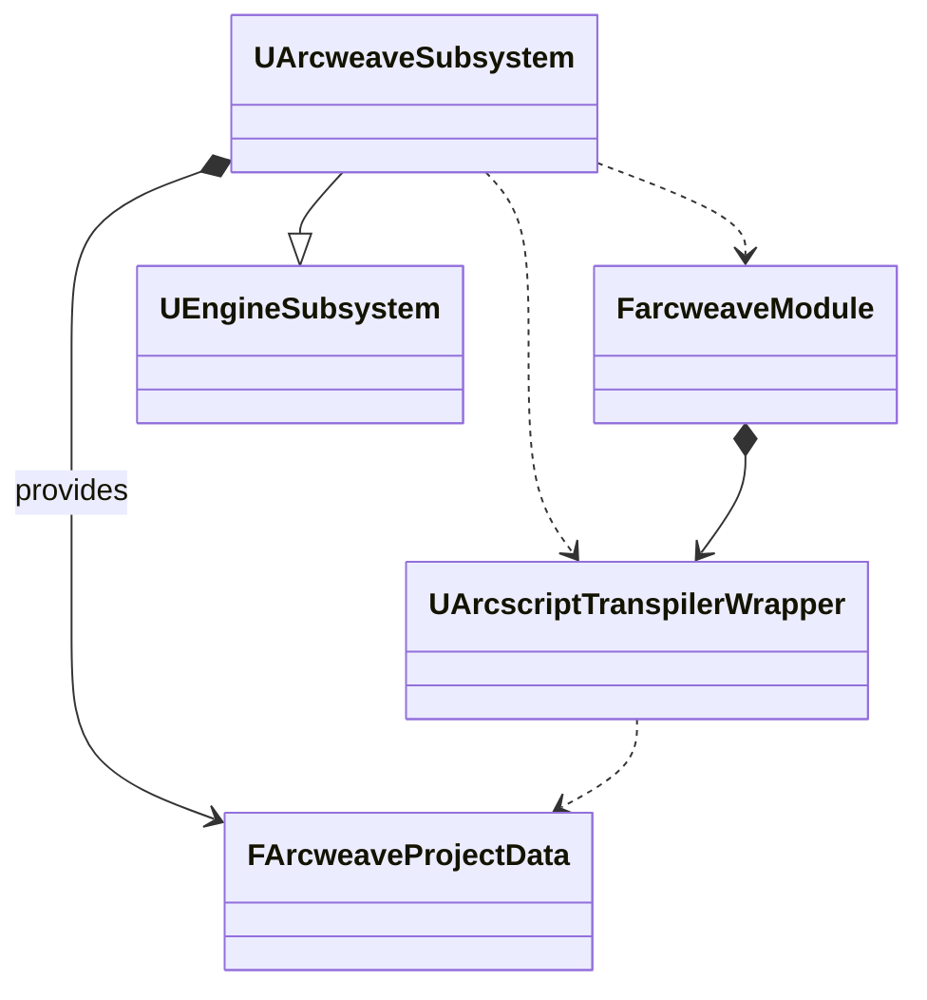
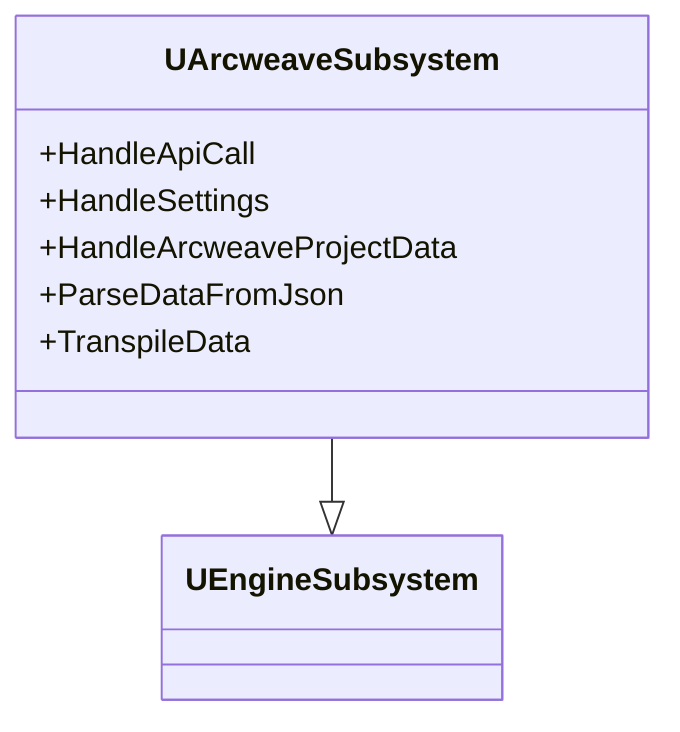
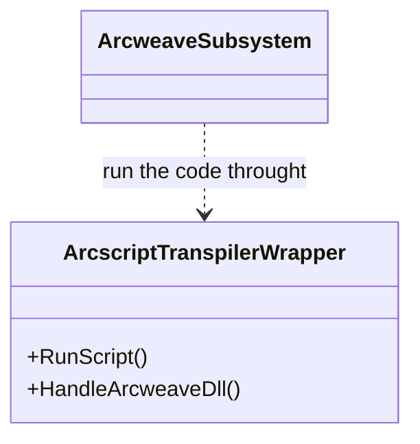
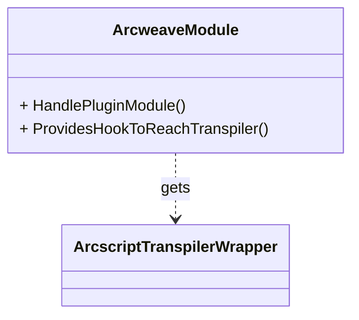
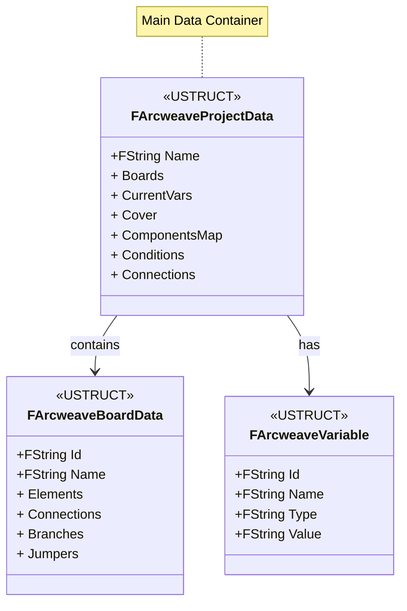
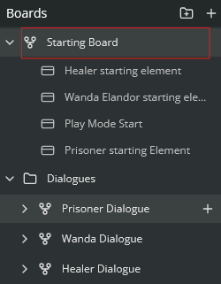
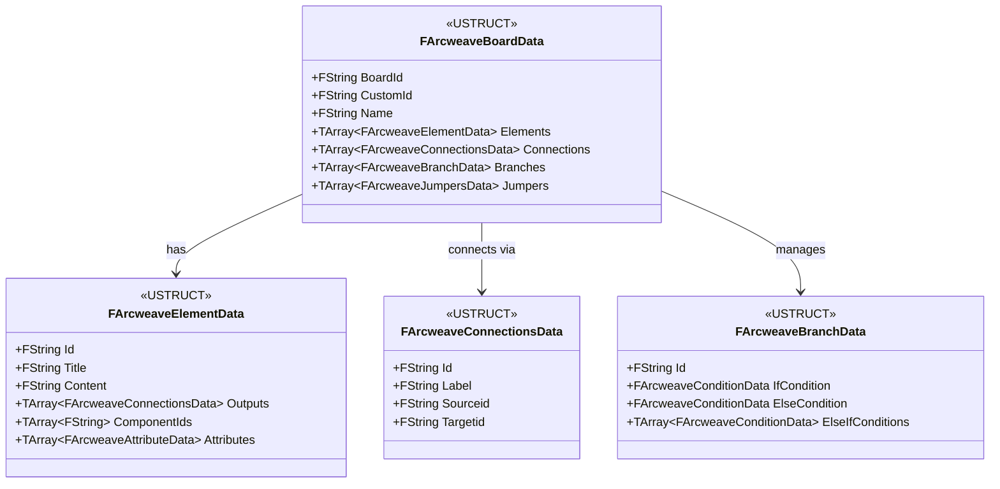
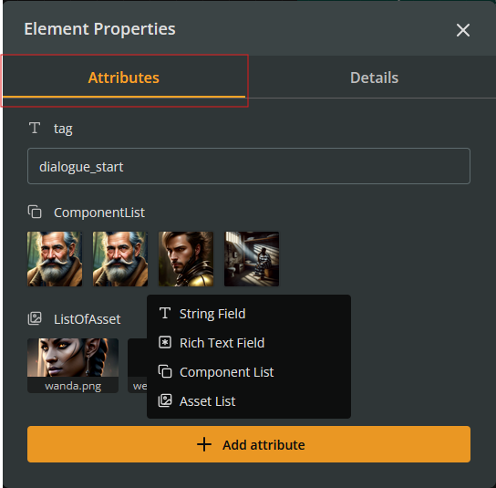
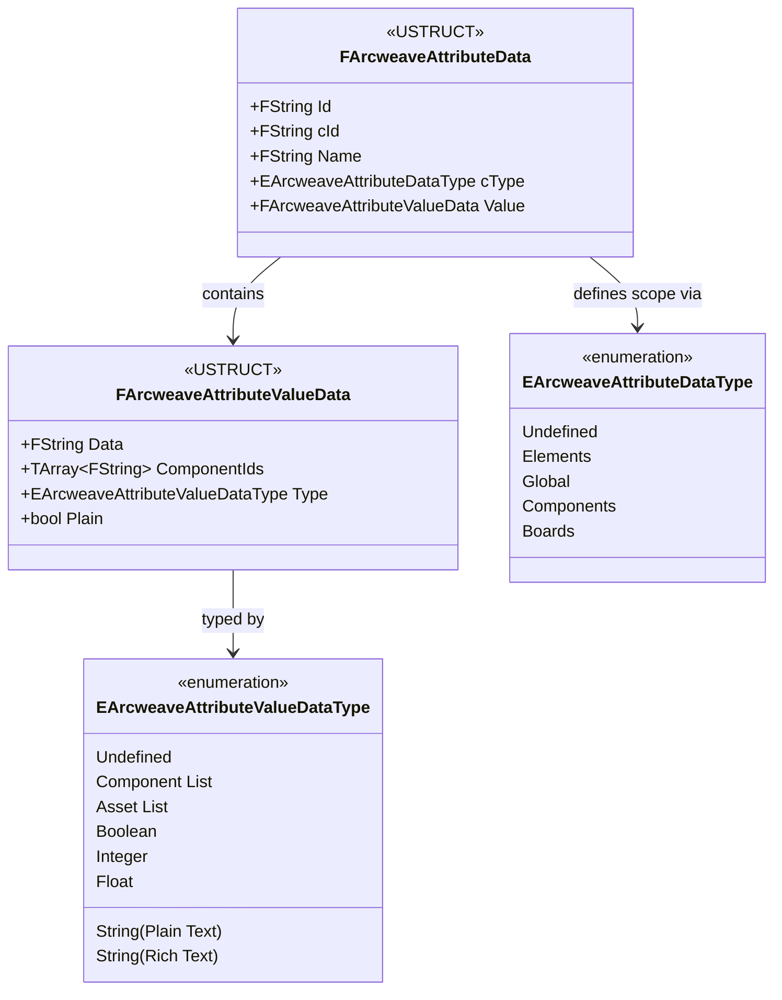

# Arcweave Plugin for Unreal Engine

[](https://github.com/arcweave/arcweave-unreal-plugin)
[](https://www.unrealengine.com/)
[](https://isocpp.org/)
[](LICENSE)
[](https://github.com/arcweave/arcweave-unreal-plugin/issues)
[](https://discord.gg/atVXxAK)
[](https://www.youtube.com/playlist?list=PLP2s5PcDiBdYRg0zHpJTuiDVf9JF_inyH)

[](https://www.youtube.com/watch?v=Ws_Cz-IQQYg)

This is the official README file for the Arcweave plugin repository, which facilitates the import of [Arcweave](https://arcweave.com/) projects into Unreal Engine (version 5.5 and later).
The plugin can import data from an exported Arcweave JSON file (available to all Arcweave users) or it can directly utilize Arcweave's web API to fetch data, a feature available to Arcweave Team account owners. You can watch a [full video tutorial series](https://www.youtube.com/playlist?list=PLP2s5PcDiBdYRg0zHpJTuiDVf9JF_inyH) on how to install and use the plugin.

## Table of Contents

- [Plugin Installation](#plugin-installation)
- [Packaging](#packaging)
- [Data Collection Methods](#data-collection-methods)
   - [JSON Import](#json-import)
   - [Web API](#web-api)
- [Localization](#localization)
- [Important Classes and Functions](#important-classes-and-functions)
   - [UArcweaveSubsystem Functions](#list-of-important-functions-in-uarcweavesubsystem)
   - [Starting element](#starting-element)
   - [Scoped variables](#scoped-variables)
   - [Runtime save/load](#runtime-saveload)
   - [ArcscriptTranspilerWrapper](#arcweave-transpiler-script-wrapper-arcscripttranspilerwrapper)
   - [ArcweaveModule](#plugin-module-arcweavemodule)
   - [Data structs](#data-structs)
- [Breaking changes / upgrading](#breaking-changes--upgrading)
- [Using the Demo Project](#using-the-demo-project)
- [Support](#support)
- [License](#license)

## Plugin Installation

To install the Arcweave Plugin for Unreal Engine, follow these steps:

1. Download [ArcweaveForUnreal.zip](https://github.com/arcweave/arcweave-unreal-plugin/releases/latest/download/ArcweaveForUnreal.zip) from the [latest release](https://github.com/arcweave/arcweave-unreal-plugin/releases/latest).
2. Extract it into the **ProjectRootDirectory/Plugins** folder, so that the plugin ends up in **ProjectRootDirectory/Plugins/Arcweave**. If the **Plugins** folder does not exist please create it. When upgrading, delete the previous copy of the plugin first, so that the project does not contain two copies of it.
3. Open your project.
4. If prompted to rebuild the Arcweave plugin, click **Yes**.

The plugin requires Unreal Engine 5.5 or later. It runs Arcscript with prebuilt libraries for **Windows (Win64)** and
**macOS on Apple Silicon (arm64)**, so those are the platforms it supports. The macOS libraries are arm64 only: Intel Macs and
the x86_64 part of a universal build are not supported.

## Packaging

- **Local JSON:** the export in `Content/ArcweaveExport` is not an Unreal asset, so it isn't packaged by default. Add the
  folder in **Project Settings → Packaging → Additional Non-Asset Directories to Package** (`ArcweaveExport`, relative to
  `Content`), as the [demo project](https://github.com/arcweave/arcweave-unreal-example) does. This adds
  `+DirectoriesToAlwaysStageAsUFS=(Path="ArcweaveExport")` to `Config/DefaultGame.ini`. If you changed
  `JsonDirectoryPath`, keep the folder under `Content` and stage it by its path relative to `Content`: for example
  `JsonDirectoryPath` `Content/Narrative/` and the packaging entry `Narrative`. A folder outside `Content`, or an absolute
  path, works in the editor but is not packaged.
- **API token:** clear the token from the Arcweave settings before you package; see [Web API](#web-api).
- **Libraries and notices:** the Arcscript libraries and the license notices of the bundled Arcscript and ANTLR runtimes
  are staged with the game automatically.

## Data Collection Methods
There are two primary methods for collecting Arcweave project data:

### JSON Import: 
For this method, you'll need to do the following: 
- Export your Arcweave project for Unreal Engine and unzip it.
- Move the exported JSON file along with all required assets in the **Content->ArcweaveExport** directory. If this directory does not exist create it.
- ⚠️ Make sure you set the tick to the field "Enable receive method from local JSON" inside Unreal under ProjectSettings at the tab "Arcweave Settings"

  

### Web API:
This involves fetching data directly from the Arcweave Web API within Unreal Engine. You will need:

- Your **Arcweave API key** and your **project's hash** (Refer to the [Arcweave Documentation](https://docs.arcweave.com/rest-api/overview) for more info on how to find these).
- Navigate to Project Settings -> Plugins -> Arcweave. Here, you can input your APIToken and the project hash obtained in the previous step.

> **Keep your API token private.** The plugin never writes the token to the log, but the token entered above is saved in
> `Config/DefaultGame.ini`, which is usually committed to version control and packaged with your game. Clear any saved
> `APIToken` before you commit or package, whichever import method you use. Switching to a local JSON import does not remove
> a token that is already saved. For shipped builds, prefer a JSON export (`EnableReceiveMethodFromLocalJSON`). If you
> need to fetch at runtime, pass the token to `FetchData(APIToken, ProjectHash)` from a source you don't commit or ship,
> such as an environment variable on your development machine.

## Localization

Arcweave projects can have several languages (see [Localization](https://docs.arcweave.com/project-tools/localization)
in the Arcweave docs). Each language has an ISO code (e.g. `en`, `fr`) and a **Translates from** language, exported as the
locale's `base`. The main language has no base.

### Import settings

Set these in **Project Settings → Plugins → Arcweave**, or from Blueprints and C++ with
`SaveArcweaveLanguageSettings(bUseLocale, bFallbackToDefaultLocale, CustomLocale)`:

| Setting | Default | Effect |
| ------- | ------- | ------ |
| `bUseLocale` (**Use Locale**) | off | Off: the project is imported in its main language. On: it is imported in `Locale`. |
| `Locale` | `en` | ISO code of the language to import. |
| `bFallbackToDefaultLocale` (**Fallback To Default Locale**) | on | On: a missing translation is taken from the fallback chain below. Off: it stays empty. |

`SaveArcweaveLanguageSettings` only changes `bFallbackToDefaultLocale` and `Locale` when `bUseLocale` is true.
The settings apply to the next import, and how they apply depends on the import method below.

### Exports with several languages

- **JSON import with all languages:** in Arcweave, use **Export as JSON** (not **Export for Unreal**, which exports a
  single language) and choose **All languages** under
  [Languages to export](https://docs.arcweave.com/project-tools/export#export-languages). The JSON then contains every
  language (`locales` and `contents`), the plugin imports the one from the settings, and you can switch language at
  runtime. `Locale` is matched to the project's languages ignoring case (`FR` finds `fr`); if the project doesn't have
  it, the import logs a warning and uses the main language.
- **JSON import with one language:** an **Export for Unreal**, or an **Export as JSON** with **Current language** or
  **Select language**, contains a single language. The plugin imports that language whatever the settings say, and
  can't switch language at runtime.
- **Web API:** the plugin requests a single language. With `bUseLocale` on, it sends `Locale` as the export's `locale`,
  and `fallbackContents=true` when `bFallbackToDefaultLocale` is on; otherwise it gets the main language. The API
  matches the code exactly: a code in a different case (`FR` for `fr`), or one the project doesn't have, is rejected
  with HTTP 400. The import then fails: `OnArcweaveFetchCompleted` reports it and the previously loaded project is kept.
  Two codes are special: `__default__` requests the main language, and `*` requests all languages, so the import is
  in the main language and can switch language at runtime like an **All languages** JSON export. Otherwise API imports
  can't switch language at runtime.

### Switching language at runtime

- `HasLocales()` is true when the imported project has more than one language and their translations, i.e. an
  **All languages** JSON export of a project with several languages.
- `UpdateContentsWithLocale(DesiredLocale)` switches the imported texts to another project language: element titles and
  contents, connection labels (including the outputs of each element and the elements that jumpers point to) and
  component names. Like the settings, the locale is matched ignoring case, and missing translations follow
  `bFallbackToDefaultLocale`. It returns false and changes nothing when `HasLocales()` is false or the project doesn't
  have the language.
- `OnArcweaveLanguageChanged(DesiredLocale)` is broadcast after a successful switch, with the project's ISO code.

The language you switch to doesn't change the settings and lasts until the next import, which uses the settings again.
Texts you already displayed are not updated: refresh your UI from the project data. `TranspileObject` runs the element's
Arcscript and counts a visit, so calling it again just to redraw the current element repeats its effects.

```cpp
UArcweaveSubsystem* Arcweave = GEngine->GetEngineSubsystem<UArcweaveSubsystem>();
if (Arcweave->HasLocales() && Arcweave->UpdateContentsWithLocale(TEXT("fr")))
{
    // The next texts you read or transpile are in French
}
```

### Fallback chain

When a language has no translation for a text, and `bFallbackToDefaultLocale` is on, the plugin tries the language's base,
then the base's base, until it reaches the main language. For example, with `fr-CA` → `fr` → `en`, a text missing in
`fr-CA` is taken from `fr`, and from `en` if `fr` doesn't have it either. A missing, `null` or empty (`<p></p>`) title,
content or label counts as missing. Translations in languages outside the chain are never used, and a loop of bases
(e.g. `it` → `fr` → `it`) is logged and ends with an empty text.

## Important Classes and Functions

### Runtime import results

Bind `OnArcweaveResponseReceived` to apply a successfully loaded project. Bind
`OnArcweaveFetchCompleted(bool bSuccess, const FString& Message)` to show the API
result in your own UI, including Shipping builds. Failures cover request startup,
transport/timeouts, HTTP errors and invalid JSON exports. A failed import keeps
the previous project; error messages do not include the response body or token.

API requests have a 20-second timeout. Starting a new API import, loading local
JSON or calling `CancelFetch()` cancels the previous request. Cancelled requests
do not emit a completion event and late responses are ignored. `LoadJsonFile()`
returns false for invalid JSON as well as file errors.

Run `Arcweave.Project.ImportFailures` in Unreal Automation to verify malformed
exports, failed requests, retries and cancellation.


The primary class that contains all the blueprint-exposed functions and data is **UArcweaveSubsystem**. This class is located in the file path `Plugins\arcweave\Source\arcweave\Public\ArcweaveSubsystem.h`. 
It provides a range of functions that can be utilized in both Blueprints and C++ to interact with, modify, and retrieve data.

#### List of Important Functions in `UArcweaveSubsystem`:

1. **Fetch Data from Arcweave API or local JSON**
   - This function allows you to fetch data from the Arcweave API by providing the API token and project hash.

2. **Load Arcweave API Token from Settings**
   - This function retrieves the Arcweave API token from the settings.

3. **Save Arcweave API Token to Settings**
   - This function saves the Arcweave API token to the settings, using the provided API token and project hash.

4. **Get Arcweave Project Data**
   - This function retrieves the Arcweave project data.

5. **Run Transpiler for the Element and Increase Visits Counter**
   - This function runs the transpiler for a specific element and increases the visits counter for that element. It requires the object ID as an input.

6. **Run Transpiler for the Condition**
   - This function runs the transpiler for a specific condition. It requires the condition ID as an input.

7. **Set Variable**
   - This function lets you modify the current variable value outside the dialogue logic. From anywhere in the project. You only need to provide the variable ID.

These functions provide a comprehensive set of tools for interacting with the Arcweave API and managing project data within your Unreal Engine project.

#### Starting element

After a successful local or API import, `FArcweaveProjectData.StartingElementId` contains the exported `startingElement` ID. Read it from `GetArcweaveProjectData()` or the project data supplied by `OnArcweaveResponseReceived`. Each successful import replaces the previous value; a rejected import preserves the loaded project.

The value is empty, and the import logs a warning that names the reason, when the export has no starting element (the field is missing, `null` or empty), or when its ID is not an element of the project or not on an imported board (for example an export of selected boards). The import still succeeds, like in the Unity plugin. Set a starting element in Arcweave and import again to play the project. Passing an empty ID to `TranspileObject` fails and logs that the project has no valid starting element.

Importing does not execute the starting element. When the game is ready to run it, pass the ID to `TranspileObject`:

```cpp
#include "ArcweaveSubsystem.h"
#include "Engine/Engine.h"

// Run after a successful import.
UArcweaveSubsystem* Arcweave = GEngine->GetEngineSubsystem<UArcweaveSubsystem>();
const FString StartingElementId = Arcweave->GetArcweaveProjectData().StartingElementId;
if (!StartingElementId.IsEmpty())
{
    bool bSuccess = false;
    FArcweaveElementData Element = Arcweave->TranspileObject(StartingElementId, bSuccess);
    // Use Element when bSuccess is true.
}
```

In Blueprints, break the `ArcweaveProjectData` struct, read **Starting Element Id**, and connect it to the transpiler node's **Object Id** input when nonempty. This is the project-wide starting element; it does not identify a separate entry for every board.

Run `Arcweave.Project.StartingElement` in Unreal Automation to verify imports, reimports, and explicit execution using the imported ID.

#### Scoped variables

Boolean, integer, float, and plain-string attributes can be used as Arcscript variables when both the attribute and its owning board or component have custom IDs. The attribute custom ID is the variable name, the owner custom ID is its scope, and the attribute ID remains the stable ID used by `SetVariable` and variable-change events.

```arcscript
health = 100
castle.health = 10
hero.health = 20
```

All global, board, and component variables are available in `FArcweaveProjectData.CurrentVars`. Each `FArcweaveVariable` stores its mutable `Value` separately from its project-authored `DefaultValue`, so `reset` and `resetAll` continue to restore project defaults after earlier interpreter calls.

All parsed attributes remain available through the owning board, component, or element's `Attributes` collection. Only eligible board and component attributes are added to `CurrentVars` and passed to Arcscript; element attributes, unsupported attribute types, and attributes without the required custom IDs are not exposed as Arcscript variables.

For local JSON imports, re-export the project from the current Arcweave version so legacy board variables are migrated to attributes. Web API imports already use the current schema.

#### Runtime save/load

`CaptureState` and `RestoreState` save and restore current global, board, and component variable values and project visit counts through `FArcweaveRuntimeState`. Store this reflected struct in your game's `USaveGame`; the plugin does not write save files or manage the game's narrative cursor or world state.

Import the same project content before restoring. Restore validates the entire snapshot before applying it, preserves authored defaults and metadata, and emits only `OnArcweaveStateRestored`, without replaying variable-change or Arcscript events. Changed project content requires a game-specific migration; it is not accepted automatically.

See the [C++ runtime save/load guide](docs/runtime-state.md) for a `USaveGame` example, import coordination, safe resume behavior, and the `Arcweave.Project.RuntimeState` automation test.

### Arcweave Transpiler script wrapper `ArcscriptTranspilerWrapper`:

Run scripts fetched from JSON or through the Web API using Arcweave DLLs from the plugin.

### Plugin module `ArcweaveModule`:

This class provides the possibility to access the Arcweave wrapper to call the DLL functions that interpret the code inside the Arcweave app.

```cpp   
         FarcweaveModule* arcweaveModule = FModuleManager::GetModulePtr<FarcweaveModule>("Arcweave");
         UArcscriptTranspilerWrapper* ArcscriptWrapper = arcweaveModule->getArcscriptWrapper();
```
### Data structs:
Wrapper structs containing a series of Blueprint-type structs needed to use the transpiler, and convert the data from and to JSON.

[View Complete relationship between data structs UML Diagram](./docs/DataDiagramClassUML.md)

#### Project struct :`ArcweaveProjectData`
This is the struct containing the board(ref to the image below) objects, the cover, all the components, and connection present in the project



#### Board struct :`ArcweaveBoardData`


The board is the second most important container and represent what we see in the app in the red rectangle looking at the figure




#### Attribute struct: `ArcweaveAttributeData`


Attributes are metadata containers that can be attached to **Elements**, **Components**, or defined **globally** in your Arcweave project. They enable flexible data organization and provide a mechanism to store custom properties with type-safe values.



**Key Properties:**

- **Id**: Unique identifier for the attribute
- **cId**: Container ID - identifies the element, component, or project it belongs to
- **Name**: Human-readable name of the attribute
- **cType**: Defines the scope of the attribute (Elements, Global, Components, or Boards)
- **Value**: Contains the actual data and type information

**Attribute Value Properties:**

- **Data**: The actual value stored as a string
- **ComponentIds**: Array of component IDs if the attribute references components
- **Type**: The data type of the attribute value (String, Rich Text, Component List, Asset List, Boolean, Integer, or Float)
- **Plain**: Boolean flag indicating if the string is plain text or rich text

**Usage Example:**

<details>

Components in `AttributeData` can be accessed using the IDs stored inside the "ComponentIds" array in `AttributeValueData` through the blueprint callable method `TryGetArcweaveComponentById`:

```cpp
// Get the Arcweave subsystem
UArcweaveSubsystem* ArcweaveSubsystem = GEngine->GetEngineSubsystem<UArcweaveSubsystem>();
if (!ArcweaveSubsystem)
    return;

// Access attributes from an element
for (const FArcweaveAttributeData& Attribute : ElementData.Attributes)
{
    FString AttributeName = Attribute.Name;
    FString AttributeValue = Attribute.Value.Data;
    EArcweaveAttributeValueDataType ValueType = Attribute.Value.Type;

    // Handle different attribute types
    switch (ValueType)
    {
        case EArcweaveAttributeValueDataType::String:
        {
            // Handle plain text
            break;
        }
        case EArcweaveAttributeValueDataType::StringRichText:
        {
            // Handle rich text
            break;
        }
        case EArcweaveAttributeValueDataType::ComponentList:
        {
            // Handle component list - iterate through all component IDs referenced by this attribute
            for (const FString& ComponentId : Attribute.Value.ComponentIds)
            {
                FArcweaveComponentData ReferencedComponent;
                if (ArcweaveSubsystem->TryGetArcweaveComponentById(ReferencedComponent, ComponentId))
                {
                    // You can now work with the component data
                    // For example, access its attributes
                    for (const FArcweaveAttributeData& ComponentAttribute : ReferencedComponent.Attributes)
                    {
                        UE_LOG(LogTemp, Warning, TEXT("  Component Attribute: %s = %s"), 
                            *ComponentAttribute.Name, *ComponentAttribute.Value.Data);
                    }
                }
            }
            break;
        }
        case EArcweaveAttributeValueDataType::AssetList:
        {
            // Handle asset references
            break;
        }
        default:
        {
            break;
        }
    }
}
```
</details>

## Breaking changes / upgrading

Attribute and component handling changed in this release. Existing C++ code that uses the old members will not compile, and Blueprints that use the old pins will show broken nodes until they are updated. These changes are part of version 3.0.0 (the previous release was 2.2.0).

| Before | Now |
| ------ | --- |
| `FArcweaveElementData::Components` (`TArray<FArcweaveComponentData>`, copies) | `FArcweaveElementData::ComponentIds` (`TArray<FString>`) |
| `FArcweaveProjectData::Components` (`TArray<FArcweaveComponentData>`) | `FArcweaveProjectData::ComponentsMap` (`TMap<FString, FArcweaveComponentData>`, keyed by component id) |
| `FArcweaveAttributeData::cType` (`FString`) | `EArcweaveAttributeDataType` (`Elements`, `Global`, `Components`, `Boards`, `Undefined`) |
| `FArcweaveAttributeValueData::Type` (`FString`) | `EArcweaveAttributeValueDataType` (`String`, `StringRichText`, `ComponentList`, `AssetList`, `Boolean`, `Integer`, `Float`, `Undefined`) |

**Upgrading**

1. Replace reads of `Element.Components` with a loop over `Element.ComponentIds`, resolving each id with `UArcweaveSubsystem::TryGetArcweaveComponentById`. Check the returned boolean, and guard against elements whose `ComponentIds` array is empty before reading index 0.
2. Replace reads of `ProjectData.Components` with `ProjectData.ComponentsMap` (use `Find(Id)` or iterate the map).
3. Replace string comparisons such as `Attribute.cType == TEXT("components")` or `Attribute.Value.Type == TEXT("string")` with the enum values. Rich text is now reported as `StringRichText` (a `"string"` value with `plain: false`); plain text stays `String`.
4. In Blueprints, refresh or re-create the nodes that used `Components`, `cType` or `Value.Type`, and switch on the new enums.

**Behaviour changes**

These don't break the build, but a game that relied on the old behaviour acts differently:

- **Unreal Engine 5.5 or later is supported.** Earlier READMEs said 5.0, but the plugin already needed 5.4 to build
  (it uses `EAllowShrinking`), and 5.5 is the oldest version it is developed on.
- **Showing a choice label no longer applies its Arcscript.** `TranspileConnectionLabel` and `TranspileConnection` used to
  apply a label's assignments and events, such as `resetVisits()`, every time the label was rendered. Now they only
  return the text. Call `UpdateVariablesFromConnection` with the connection the player picks to apply its effects;
  `visits()` in the label then counts the visits of the element the connection starts from. Checking branch conditions
  (`TranspileCondition`, `GetIsTargetBranch`) doesn't change variables or visits either.
- **The starting element is validated on import.** `StartingElementId` is empty, with a warning, when the exported ID is
  not an element on an imported board. See [Starting element](#starting-element).
- **The API token is no longer logged.** The settings read on import are logged at `Verbose` under `LogArcwarePlugin`,
  and the token only as `set` or `empty`.

## Using the Demo Project

You can explore the plugin implementation and see examples of its usage in our [Arcweave demo project](https://github.com/Arcweave/arcweave-unreal-example). 
This project includes a demo scene and samples of logic implementation using Arcweave's Web API, showcasing all the capabilities of the plugin.

## Support

If you need support for an issue, you can open it using the [CONTRIBUTING.MD](CONTRIBUTING.MD) guide on GitHub or you can reach out on the [🔗 Discord server](https://discord.gg/atVXxAK).

## License

The plugin is available under the [MIT license](LICENSE). The bundled Arcscript and ANTLR runtimes retain their [BSD 3-Clause licenses](THIRD_PARTY_NOTICES.md); their notices are included in packaged games.
